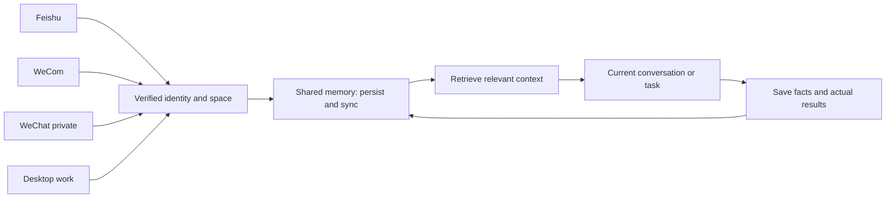

# KODER Shared Memory

English | [简体中文](README.zh-CN.md) · **v1.0.0**

[](skills/koder-shared-memory/SKILL.md)
[](LICENSE)
[](#project-status)
[](https://github.com/KarmenLoop/koder-shared-memory/releases)

**A portable skill for keeping approved work context across linked chats and devices—recall before you act, save what actually happened, keep execution under the host.**

KODER Shared Memory describes what an agent should recall, what it should save, and how to handle corrections and unfinished tasks. Built for [Koder](https://karmenloop.com); other hosts can adapt it if they provide identity, storage, retrieval, and sync. This repository ships the **instructions and integration contract**, not a hosted memory service, chat connector, or sync daemon.

[Download](https://github.com/KarmenLoop/koder-shared-memory/releases/latest) · [Tutorial](docs/tutorial.en.md) · [中文教程](docs/tutorial.zh-CN.md) · [Getting started](docs/getting-started.md) · [Contributing](CONTRIBUTING.md) · [Support](SUPPORT.md)

---

## Why this exists

A task can start in a private chat and continue in a group or on a desktop. Without shared rules, agents either forget decisions or silently replay commands on the wrong device. This skill gives the host a contract for carrying relevant decisions, constraints, preferences, and progress—while keeping **live conversations independently routed** and **execution authority separate from memory visibility**.

Once an account, channel, or device is linked, its conversations use the linked memory space by default. Linking a group can expose associated private-chat memory to its members; the host must explain that behavior **before** the owner links it.

---

## Snapshot

| | |
| --- | --- |
| **What you install** | Portable skill package (`SKILL.md` + metadata) via ZIP or folder load |
| **Version** | **1.0.0** (`VERSION`, initial publication) |
| **Runtime dependency** | Host with skill loading + persistent memory tools; packaging uses Python **3.10+** stdlib |
| **Network (packaging)** | Local checks and zip build do **not** contact models or messaging accounts |
| **Intended surfaces** | Feishu / WeCom groups & private chats · WeChat private · desktop CLI/app/editor paths · linked devices |
| **License** | [Apache License 2.0](LICENSE) |
| **Not included** | Hosted sync server, platform login adapters, automatic command replay |

---

## Is / Is not

| Is | Is not |
| --- | --- |
| Skill + contract for cross-channel / cross-device context | Cloud memory SaaS or sync daemon |
| Recall before work; save facts and actual results | Silent re-approval or replay of executable queues |
| Linked-group policy with disclosed private-memory access | Hidden merge of unrelated accounts or spaces |
| Provenance, versions, conflicts, deletion, sync receipts | Claim that packaging checks prove live platform sync |
| Portable Markdown skill for Koder and adaptable hosts | Guaranteed default recall on every host without host wiring |

---

## What it covers

- **Recall before work.** Retrieve relevant decisions, constraints, and task state before answering or acting.
- **Save as work happens.** Record meaningful decisions and actual results—including failures, cancellations, and unfinished work.
- **Continue across channels and devices.** Use verified space and task references, not machine-specific directory names.
- **Include the whole linked group (disclosed).** Members of a linked group may use associated private-chat memory in that space.
- **Respect the model window.** Retrieve bounded relevant material; keep the complete record in persistent storage.
- **Keep execution under the host.** Remembering an action does not approve it again or replay it elsewhere.

## Platforms (requirements, not a tested matrix)

| Entry point | Shared scope | Host requirement |
| --- | --- | --- |
| Feishu | Private and group chats | Verified binding, admitted inbound messages, memory tools |
| WeCom / WeChat Work | Private and group chats | Same as above |
| WeChat | Private chats | Working private-chat connector + memory tools |
| Desktop | CLI, app, editor, coding, file/browser work | Skill loading and memory access on each path |
| Additional computers / phones | Same linked space | Verified device association + working synchronization |

The table describes intended sharing behavior. It does **not** claim every connector is installed or tested in a particular Koder build. The skill can only remember work the host observes or imports through authorized capabilities.



---

## Quickstart

```bash
git clone https://github.com/KarmenLoop/koder-shared-memory.git
cd koder-shared-memory
python3 scripts/check_repository.py
python3 scripts/package_skill.py
```

Import `dist/koder-shared-memory.skill.zip` with your Koder skill/resource importer, or load `skills/koder-shared-memory/` if the host accepts folders. Keep the skill enabled on every entry point you want to link. Then:

1. Confirm the host can resolve a trusted space, persist/retrieve memory, and report **actual** sync state.
2. Link accounts/devices through the host’s supported sign-in flow.
3. Try a small handoff: save a test decision on desktop → retrieve in private chat → retrieve as another member of a linked group.

Full walkthrough: [tutorial](docs/tutorial.en.md) · [getting-started](docs/getting-started.md) · [integration](docs/integration.md).

### What gets shared

| Included | Kept outside shared memory |
| --- | --- |
| Relevant conversation content and explicit preferences | Passwords, API keys, tokens, session secrets |
| Decisions, constraints, task progress | Live approval tickets and device permissions |
| Verified tool results, failures, cancellations | Executable queues to replay automatically |
| Artifact references, summaries, versions | Hidden model reasoning |
| Source / author / channel / device / task refs when available | Content from unrelated or unlinked spaces |

Sharing memory does **not** automatically transfer files. **Group visibility matters:** linked-group members may use associated private-chat memory; explain that before linking.

---

## Project status

Initial publication: English skill, host requirements, memory contract, validation scenarios, contribution guidance, and local packaging tools.

Packaging checks validate repository structure, local documentation links, and archive contents. They do **not** establish that a real chat platform or a second physical device has synchronized successfully. Host integrations must record those results separately — see [validation](docs/validation.md).

---

## Documentation

| Guide | Use it for |
| --- | --- |
| [Tutorial (EN)](docs/tutorial.en.md) · [中文](docs/tutorial.zh-CN.md) | Import, first handoff, troubleshoot, update, remove |
| [Getting started](docs/getting-started.md) | Import and first handoff (EN detail) |
| [Host integration](docs/integration.md) | Tools, identity, execution boundaries |
| [Memory model](docs/memory-model.md) | Provenance, versions, deletion, sync states |
| [Validation](docs/validation.md) | Cross-channel / cross-device scenarios |
| [FAQ](docs/faq.md) | Limits and common questions |
| [Changelog](CHANGELOG.md) · [Release](RELEASE.md) | Versioning |

---

## FAQ

### Does importing the skill connect my chat accounts?

No. The host supplies connectors, sign-in, and verified bindings.

### Does this include a cloud memory server?

No. Cross-device synchronization requires a working host service.

### Can everyone in a linked group use private-chat memory?

Yes, for **associated** private-chat memory in that linked space—disclose this when linking. Unrelated spaces stay separate.

### Does shared memory give a group control of my computer?

No. Memory visibility and execution authority are separate.

### Soft discoverability

Useful phrases: **shared memory skill for agents**, **cross-channel context for Feishu WeCom WeChat**, **linked-group private memory policy**, **portable SKILL.md memory contract**, **host integration without silent command replay**. Avoid stuffing; substance is in the skill and integration guides.

---

## License and contact

[Apache License 2.0](LICENSE). Keep required notices and identify changes when distributing modified files. The license covers this repository’s files; it does not relicense Koder’s runtime, connectors, or model services. See [NOTICE](NOTICE).

Issues: [GitHub Issues](https://github.com/KarmenLoop/koder-shared-memory/issues) · Security: [SECURITY.md](SECURITY.md) · Support: [SUPPORT.md](SUPPORT.md). Never attach private conversations, credentials, or customer data.
