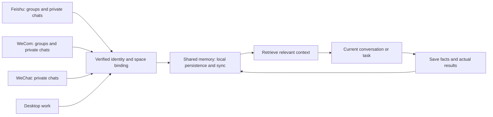

# KODER Shared Memory

KODER Shared Memory is a skill for keeping work context across linked chats and devices. It describes what an agent should recall, what it should save, and how to handle corrections and unfinished tasks.

[](skills/koder-shared-memory/SKILL.md)
[](LICENSE)
[](#project-status)
[](https://github.com/KarmenLoop/koder-shared-memory/releases)

[Download](https://github.com/KarmenLoop/koder-shared-memory/releases/latest) · [Quickstart](#quickstart) · [Platforms](#platforms) · [Documentation](#documentation) · [Contributing](CONTRIBUTING.md) · [Support](SUPPORT.md) · [License](LICENSE)

## Overview

A task can start in a private chat and continue in a group or on a desktop. This skill gives the host a set of rules for carrying the relevant decisions, constraints, preferences, and progress along with it.

Once an account, channel, or device is linked, its conversations use the linked memory space by default. Linking a group can expose associated private-chat memory to its members; the host must explain that behavior before the owner links it.

The skill was written for KODER. Other hosts can adapt it if they provide identity checks, storage, retrieval, and sync. This repository supplies the instructions and integration contract, not a hosted service, chat connector, or sync daemon.

## What it covers

- **Recall before work.** Retrieve relevant decisions, constraints, and task state before answering or taking action.
- **Save as work happens.** Record meaningful decisions and actual results while they are fresh, including failures, cancellations, and unfinished work.
- **Continue across channels.** Use the same verified space across private chats, linked groups, and desktop work.
- **Include the whole linked group.** Members of a linked group can use associated private-chat memory in that space. Hosts must explain this behavior before linking a group.
- **Continue across devices.** Use stable space and task references rather than machine-specific directory names.
- **Keep the record straight.** Preserve provenance, versions, conflicts, deletion records, and real synchronization receipts.
- **Respect the model's context window.** Retrieve relevant material and bounded summaries while keeping the complete record in persistent storage.
- **Keep execution under the host's control.** Remembering an action does not approve it again or replay it on another device.

## Platforms

The table describes the skill's intended sharing behavior. It is not a claim that a connector has been installed or tested in a particular KODER build.

| Entry point | Shared scope | Host requirement |
| --- | --- | --- |
| Feishu | Private chats and group chats | Verified channel binding, admitted inbound messages, and memory tools |
| WeCom / WeChat Work | Private chats and group chats | Verified channel binding, admitted inbound messages, and memory tools |
| WeChat | Private chats | A working private-chat connector and memory tools |
| Desktop | CLI, desktop app, editor, coding, file work, browser work, and other authorized tool activity | Skill loading and memory access in each execution path |
| Additional computers and phones | The same linked memory space | Verified device association and working synchronization |

The skill can remember work that KODER observes or imports through authorized capabilities. It cannot reconstruct activity from an application the host has never connected to.

## How it works



Memory is shared; live conversations stay independently routed. A question asked in a Feishu group is answered in that group. A pending desktop approval stays attached to its original operation. Another device can learn what happened without silently running the same command again.

## Quickstart

### Import into KODER

1. Download the skill package from [Releases](https://github.com/KarmenLoop/koder-shared-memory/releases/latest), or clone the repository:

   ```bash
   git clone https://github.com/KarmenLoop/koder-shared-memory.git
   cd koder-shared-memory
   ```
2. Run the local checks and build the portable package:

   ```bash
   python3 scripts/check_repository.py
   python3 scripts/package_skill.py
   ```

3. Use the skill or resource importer available in your KODER build to import `dist/koder-shared-memory.skill.zip`.
4. Keep the skill enabled across the entry points you want to link. A project-only or conversation-only setting will limit where it is available.
5. Verify that the host can resolve a trusted memory space, read and write persistent memory, and report actual sync state. Link accounts and devices through the host's supported sign-in flow.
6. Try one small handoff before relying on a larger task. Save a test decision on the desktop, retrieve it in a private chat, and then retrieve it as another member of a linked group.

The packaging tools use Python 3.10 or later and the standard library. They do not install dependencies, contact a model, access a user profile, or connect to messaging accounts.

For a host that loads skill folders directly, use `skills/koder-shared-memory/`. The included `agents/openai.yaml` enables implicit selection in hosts that support that metadata. Default recall on every entry point also requires host-level loading; metadata alone does not guarantee it.

See [Getting started](docs/getting-started.md) and the [host integration guide](docs/integration.md).

## What gets shared

| Included | Kept outside shared memory |
| --- | --- |
| Relevant conversation content and explicit preferences | Passwords, API keys, access tokens, and session secrets |
| Decisions, constraints, and task progress | Live approval tickets and device permissions |
| Verified tool results, failures, and cancellations | Executable queues and commands to replay automatically |
| Artifact references, summaries, and versions | Hidden model reasoning |
| Source, author, channel, device, and task references when available | Content from unrelated accounts or unlinked spaces |

Sharing memory does not automatically transfer files. A file needs a resource reference the receiving device can resolve and an authorized transfer path.

**Group visibility matters.** In this policy, linked-group members may use associated private-chat memory. The account owner should understand that a group answer may expose that content to the group. Unrelated spaces remain separate.

## Project status

The initial publication contains an English skill, host requirements, a memory contract, validation scenarios, contribution guidance, and local packaging tools.

Packaging checks validate repository structure, local documentation links, and archive contents. They do not establish that a real chat platform or a second physical device has synchronized successfully. Host integrations must record those results separately. See [Validation](docs/validation.md).

## Documentation

| Guide | Use it for |
| --- | --- |
| [Getting started](docs/getting-started.md) | Importing the skill and trying a first handoff |
| [Host integration](docs/integration.md) | Loading the skill, exposing tools, and preserving execution boundaries |
| [Memory model](docs/memory-model.md) | Identity, provenance, versions, deletion, and synchronization states |
| [Validation](docs/validation.md) | Testing cross-channel and cross-device behavior |
| [FAQ](docs/faq.md) | Common questions and practical limits |
| [Changelog](CHANGELOG.md) | Changes to the published skill and contract |
| [Release guide](RELEASE.md) | Versioning and publishing a verified skill package |

## Contributing

Bug reports, clearer examples, documentation fixes, and tested host adapters are welcome. Start with [CONTRIBUTING.md](CONTRIBUTING.md) and follow the [Code of Conduct](CODE_OF_CONDUCT.md). Never attach private conversations, credentials, or customer data to an issue or pull request.

For a security concern, follow [SECURITY.md](SECURITY.md). For integration help, see [SUPPORT.md](SUPPORT.md).

## License and attribution

This repository is licensed under the [Apache License 2.0](LICENSE). You can use, modify, and redistribute it, including commercially, under that license's terms. Keep the required notices and identify changes when distributing modified files.

The license applies to the files distributed in this repository. It does not relicense KODER's runtime, third-party connectors, model services, or any other project. See [NOTICE](NOTICE).

## Support the project

If the skill helps your team, give the repository a star, share a useful integration example, or contribute a focused improvement. Reports backed by actual platform and device results are especially helpful.

## Contact

Use [GitHub Issues](https://github.com/KarmenLoop/koder-shared-memory/issues) for bugs, integration questions, and feature requests. Security reports have a separate process in [SECURITY.md](SECURITY.md).
